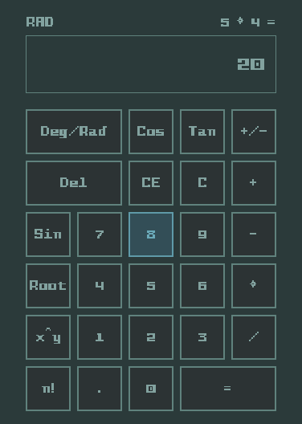

# IVS Calc

[](https://github.com/Bojacnik/ivs-projekt-2/actions/workflows/ci.yml)
[](https://github.com/Bojacnik/ivs-projekt-2/releases/latest)
[](LICENSE)

Kalkulačka s libovolnou přesností – společný projekt č. 2 předmětu IVS (FIT VUT).
Výpočty probíhají s přesností ~100 platných číslic (knihovna [MPFR](https://www.mpfr.org/)),
GUI je postavené na [raylib](https://www.raylib.com/) + [raygui](https://github.com/raysan5/raygui).



Funkce: `+ - * /`, mocnina, obecná odmocnina, faktoriál, `sin`, `cos`, `tan`
(radiány i stupně), řetězení operací, kopírování a vkládání čísel.
Ovládání je popsané v [uživatelském návodu](docs/navod.md).

## Instalace

Stáhněte balíček `.deb` z [Releases](https://github.com/Bojacnik/ivs-projekt-2/releases) a nainstalujte:

```sh
sudo apt install ./ivs-calc_*.deb
```

Kalkulačka se nainstaluje do `/opt/IVS_Calc/` a objeví se v nabídce aplikací.

## Sestavení ze zdrojových kódů

Závislosti (Debian/Ubuntu):

```sh
sudo apt install build-essential git libmpfr-dev libgmp-dev \
  libasound2-dev libx11-dev libxrandr-dev libxi-dev libgl1-mesa-dev \
  libglu1-mesa-dev libxcursor-dev libxinerama-dev
```

Všechny příkazy se spouští z kořene repozitáře:

| Příkaz              | Popis                                                                 |
|---------------------|-----------------------------------------------------------------------|
| `make`              | stáhne raylib a raygui (pevné verze), sestaví a spustí `build/calc`   |
| `make main`         | pouze sestaví kalkulačku                                              |
| `make test`         | sestaví a spustí testy (`make test SANITIZE=1` s ASan/UBSan)          |
| `make prof`         | profiling výpočtu směrodatné odchylky → `profiling/vystup.txt`        |
| `make doc`          | dokumentace Doxygen → `build/doc/html`, `build/doc.pdf` (vyžaduje LaTeX) |
| `make package`      | balíček `.deb` → `build/package/`                                     |
| `make format`       | naformátuje kód (`clang-format-18`), `make format-check` jen kontroluje |
| `make pack`         | archiv k odevzdání do IVS                                             |
| `make clean`        | smaže build výstupy a stažené závislosti                              |

## Struktura repozitáře

```
src/
  backend/      matematická knihovna (MPFR), operace nad řetězci čísel
  calculator/   logika kalkulačky – stavový automat nezávislý na GUI
  frontend/     GUI (raylib/raygui): kreslí stav a předává vstup logice
  profiling/    program pro profiling (směrodatná odchylka)
tests/          testy matematické knihovny a logiky kalkulačky
profiling/      vstupní data, výstup a zpráva z profilingu
packaging/      .desktop soubor a ikona pro balíček
docs/           uživatelská dokumentace, obrázky, návrh GUI, podklady k projektu
.github/        CI, vydávání releasů, šablony issue a PR, Dependabot
```

## Vydání nové verze

1. Zvyšte verzi v `CMakeLists.txt` (`project(IVS_Calc VERSION x.y.z)`) a `Doxyfile` (`PROJECT_NUMBER`).
2. V `CHANGELOG.md` přejmenujte `[Unreleased]` na `[x.y.z] - datum` a přidejte novou prázdnou `[Unreleased]`.
3. `git tag vx.y.z && git push origin vx.y.z`

CI sestaví balíček `.deb` a dokumentaci a připojí je k novému GitHub Release; popis vydání se
převezme z `CHANGELOG.md`.

## CI

- **CI** (každý push a pull request): formát kódu, testy (i s ASan/UBSan), sestavení `.deb`.
- **Documentation** (každou noc, jen pokud se `master` změnil; ručně přes *Actions → Run workflow*):
  Doxygen PDF a HTML jako artefakt. Instalace LaTeXu trvá ~20 minut, proto neběží u každé změny.
- **Release** (tag `v*`): testy, balíček, dokumentace, GitHub Release.

## Přispívání

Viz [CONTRIBUTING.md](CONTRIBUTING.md), [kodex chování](CODE_OF_CONDUCT.md) a
[bezpečnostní politiku](SECURITY.md). Historie změn je v [CHANGELOG.md](CHANGELOG.md).

## Prostředí

Linux 64bit (testováno na Ubuntu 24.04 a Manjaro), MPFR ≥ 4.2.

## Autoři

Cyberdyne Systems
- xnemecv00 Vít Němec
- xnovype00 Petr Nový
- xdrdlat00 Tomáš Drdla
- xmandym00 Michal Mandys

## Licence

Program je šířen pod licencí [GNU General Public License v3.0](LICENSE).
