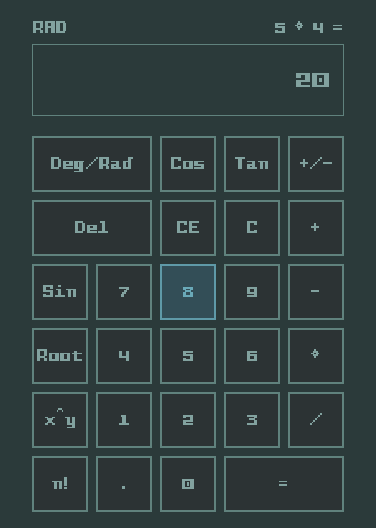

# Uživatelský návod – IVS Calc

> Tento návod popisuje aktuální verzi. Původní uživatelská dokumentace
> ([UzivatelskaDokumentace.pdf](UzivatelskaDokumentace.pdf)) odpovídá verzi odevzdané v roce 2024.

## Displej

- **Horní řádek vlevo** – jednotka úhlů pro `sin`, `cos`, `tan`: `RAD` (radiány) nebo `DEG` (stupně).
- **Horní řádek vpravo** – rozpracovaný výpočet, např. `2 +` nebo po výpočtu `2 + 3 =`.
- **Hlavní displej** – zadávané číslo nebo výsledek. Výsledky se zobrazují na 10 platných
  číslic, velmi velká a malá čísla ve tvaru `1.5e-82`. Interně se počítá s ~100 číslicemi.

## Operace

| Tlačítko  | Klávesa          | Význam                                                       |
|-----------|------------------|--------------------------------------------------------------|
| `0`–`9`   | `0`–`9`          | číslice                                                      |
| `.`       | `.` nebo `,`     | desetinná tečka                                              |
| `+/-`     | `n`              | změna znaménka                                               |
| `+ - * /` | `+ - * /`        | sčítání, odčítání, násobení, dělení                          |
| `x^y`     | `^`              | mocnina: `2 ^ 10 =` → `1024`                                 |
| `Root`    | `r`              | odmocnina: nejdřív odmocněnec, pak stupeň: `9 Root 2 =` → `3` |
| `n!`      | `!`              | faktoriál celého čísla 0–10000                               |
| `Sin`     | `s`              | sinus aktuálního čísla                                       |
| `Cos`     | `c`              | kosinus                                                      |
| `Tan`     | `t`              | tangens                                                      |
| `Deg/Rad` | `d`              | přepnutí mezi radiány a stupni                               |
| `=`       | `=` nebo `Enter` | výpočet                                                      |
| `Del`     | `Backspace`      | smaže poslední znak                                          |
| `CE`      |                  | smaže aktuální číslo (rozpracovaná operace zůstane)          |
| `C`       | `Esc` / `Delete` | smaže vše                                                    |
|           | `Ctrl+C`         | zkopíruje číslo z displeje                                   |
|           | `Ctrl+V`         | vloží číslo ze schránky                                      |

## Tipy

- **Záporné číslo** zadáte tlačítkem `-` na začátku čísla (`- 5`) nebo `+/-` kdykoli.
  Funguje i u druhého operandu: `2 * - 3 =` → `-6`.
- **Řetězení:** další operátor nejdřív spočítá předchozí operaci: `2 + 3 * 4 =` → `20`.
- **Překlep v operátoru:** stisknete-li dva operátory za sebou, platí ten druhý.
- **Funkce uprostřed výpočtu:** `2 + 3 n! =` → `8` (faktoriál se použije jen na `3`).
- **Po výsledku** začne číslice psát nové číslo, operátor pokračuje s výsledkem.
- **`Err`** znamená nedefinovaný výsledek (dělení nulou, sudá odmocnina záporného čísla,
  `tan(90°)`, faktoriál neceločíselného čísla, …). Pokračujte zadáním nového čísla.
